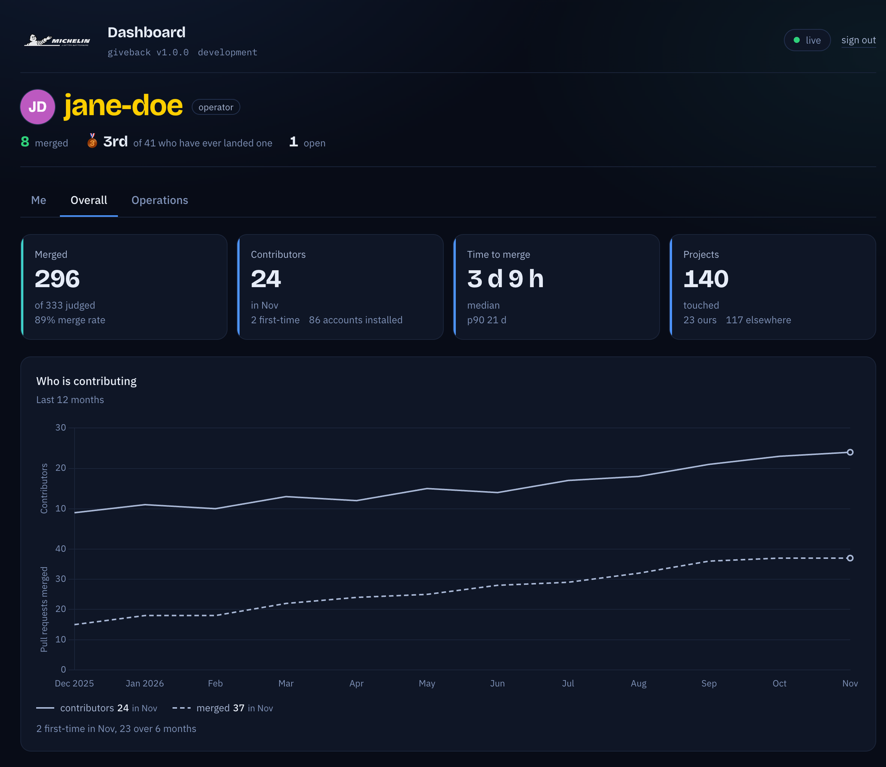
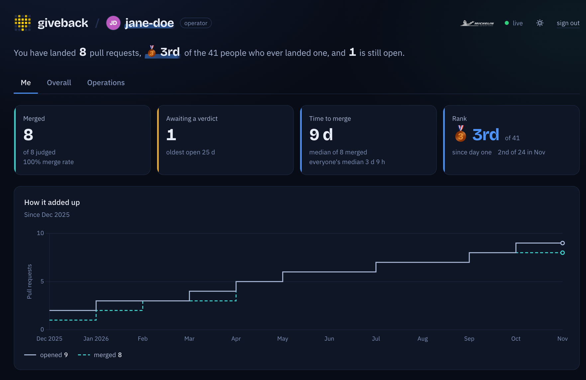
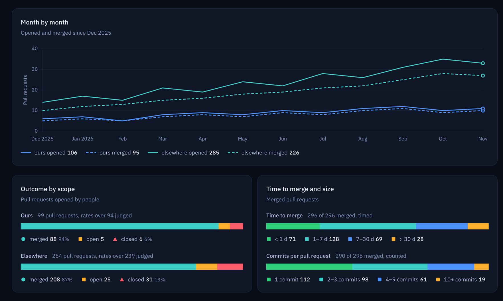
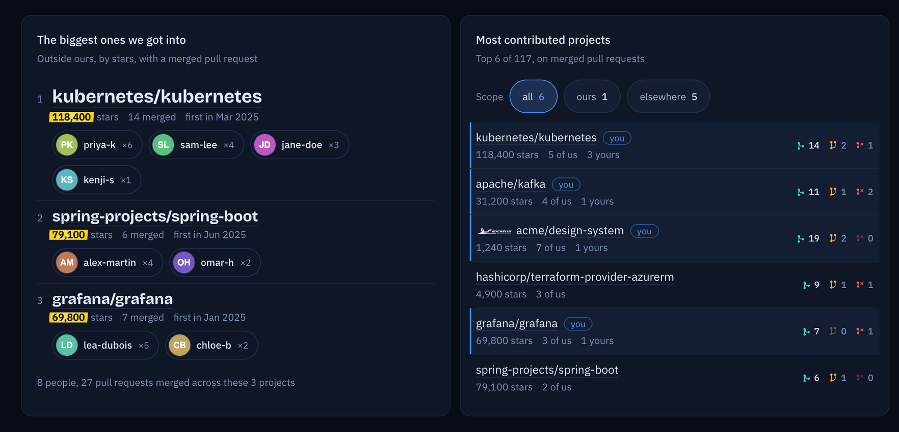
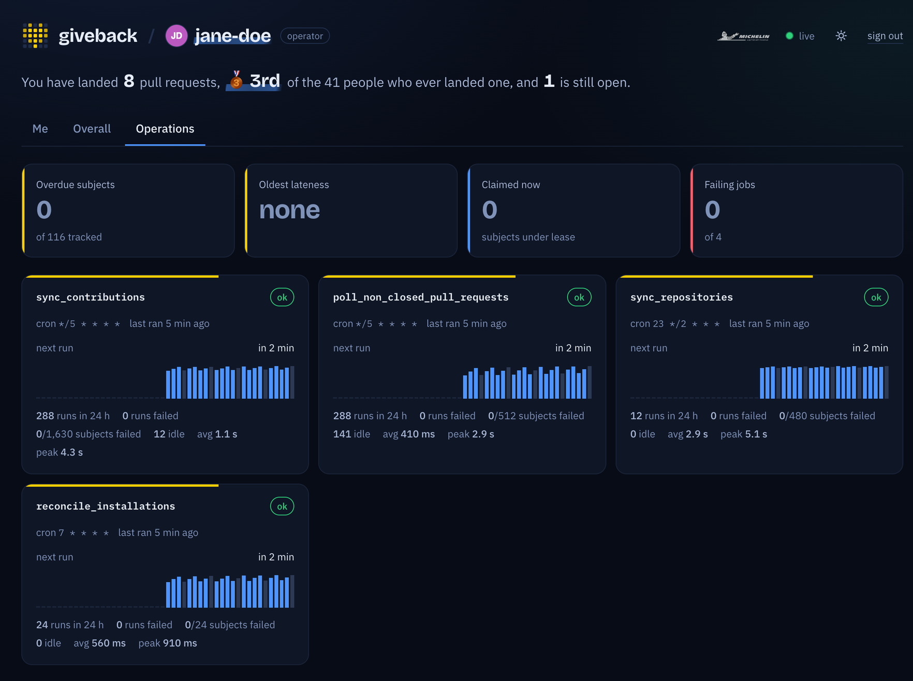
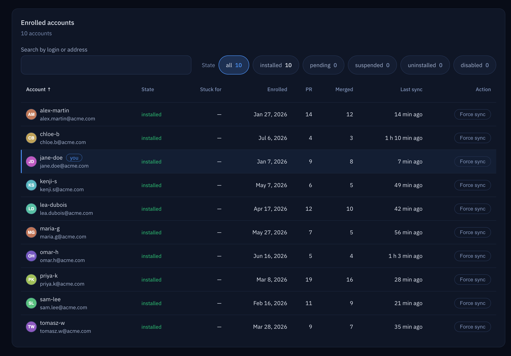
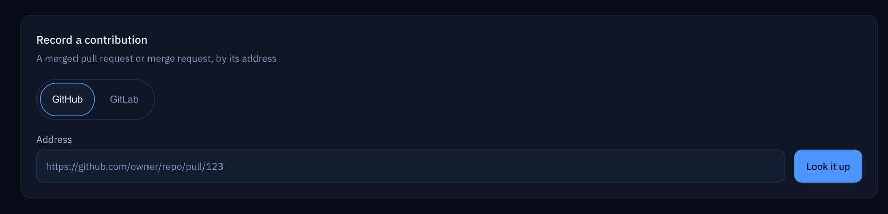

<div align="center">

<h1>
  <picture>
    <source media="(prefers-color-scheme: dark)" srcset="docs/img/logo-lockup-dark.svg">
    
  </picture>
</h1>

**Measure what your company gives back to open source.**

A GitHub App that turns your engineers' public pull requests into a live picture of your
company's open-source contribution: who contributes, to which projects, and how fast it lands.
Opt-in for every employee, and it never touches anything private.

[](https://github.com/michelin/giveback/actions/workflows/ci.yml)
[](LICENSE)

[](https://probot.github.io)



</div>

## Why giveback?

Your engineers fix bugs in Kubernetes, write docs for Kafka, and ship features to the libraries
your products run on. Almost none of it shows up anywhere. They do it from personal GitHub
accounts, in repositories your company does not own, and GitHub's insights stop at the
organization boundary.

giveback crosses that boundary, **with each person's consent**. An employee installs the App on
their own account and proves a verified corporate email address. From then on, their public
contributions are collected, kept up to date, and shown on a dashboard every enrolled employee
can read.

## Features

### 🙋 Your own track record

Every enrolled engineer gets a personal page: what they merged, what is still waiting for review,
how long their merges take compared with everyone else's, and where they rank. Every pull request
links back to GitHub.



### 🌍 The company's footprint, at a glance

Month-by-month trends that split the company's own repositories from everyone else's. Merge
rates, time to merge, pull request sizes, and the open pull requests that have been waiting the
longest.



### ⭐ The projects that matter

See the biggest upstream projects your people got merged into and who did it, plus a ranking of
the projects you contribute to most.



### 🛠️ An operations console that explains itself

Operators see the jobs, the queue, detection latency and every enrolled account, and can force a
sync with one click. When something goes wrong, the page shows what failed and why.





### ✍️ Contributions GitHub cannot see

Work that lives elsewhere still counts. An operator pastes the address of a GitHub pull request
or a GitLab merge request, giveback fills in the title, dates and counts on its own, and the
operator picks who gets the credit.



<sub>Screenshots use invented demo data.</sub>

## Private by design

- **No access to code.** The App requests no repository and no organization permission. It
  cannot see source code, private repositories, issues or any organization's data. Everything
  it collects is already public on github.com.
- **One email address, read once.** Its only permission, `emails: read`, is used at enrollment
  to find a verified address on an allowed domain. That address is stored, and the token is
  thrown away.
- **Consent is the install.** Nobody is tracked until they install the App, and uninstalling it
  stops collection.
- **Personal projects stay personal.** Contributions to a person's own repositories are not
  counted, and neither are pull requests opened by bots (Dependabot, Renovate…).

## Lightweight to run

- **One Node.js process and one PostgreSQL database.** No container, message broker, cache or
  object storage required. Run more processes if you like: they share the work through the
  database without doing it twice.
- **Fresh without hammering the API.** An active contributor's data is fresh within 15 minutes.
  Quiet accounts are checked less often, down to every 4 hours. Open pull requests are re-checked
  until they close, so a merge six weeks later still counts.
- **Make it yours.** Nothing in the code is tied to Michelin. Set your email domains and your
  GitHub organizations, swap in your logo, and you are done.

## How it works

1. **An employee installs the App** on their personal GitHub account.
2. **giveback checks their verified email** against your allowed domains, and enrolls them.
3. **It follows their public activity**: every pull request and push to a repository they do not
   own, re-checked until each pull request is merged or closed.
4. **The dashboard reports it**: a personal view, a company-wide view and an operations console.

Details: [docs/architecture.md](docs/architecture.md).

## Quick start

You need Node.js `>=24`, Docker, and a GitHub account with a verified email address.

```sh
mise install && npm install          # Node from mise.toml, then dependencies
docker compose up -d --wait          # PostgreSQL 16, schema applied
cp .env.example .env.local           # then fill it in, see the guide
npm run start:local
```

Before `npm run start:local` you need your own development GitHub App and a smee.io channel
for webhooks. [The getting started guide](docs/getting-started.md) walks you through it in seven
steps, with a pre-filled App registration form and a troubleshooting table.

Going to production? Read [docs/deployment.md](docs/deployment.md).

## Make it yours

These changes are cosmetic and none of them changes behaviour:

- `public/images/company_logo.svg`: your own SVG wordmark, shown 26 px high in every page header.
- `app.yml`: `name`, `description`, `url`.
- `package.json`: `name`, `description`.
- `views/enroll.ejs` (page `<title>` and footer link) and `views/dashboard.ejs` (`<title>`).

What counts as *your* repositories, who may enroll and who sees the operations console are
settings, not code: `OWN_GITHUB_ORGS`, `ALLOWED_EMAIL_DOMAINS` and `DASHBOARD_OPERATOR_IDS` (GitHub
account ids) in [docs/configuration.md](docs/configuration.md).

## Documentation

| | |
| --- | --- |
| [Getting started](docs/getting-started.md) | Run it locally, from clone to your own dashboard |
| [Deployment](docs/deployment.md) | What production needs, the GitHub App, the database |
| [Configuration](docs/configuration.md) | Every environment variable |
| [Architecture](docs/architecture.md) | Enrollment, the four jobs, adaptive scheduling, endpoints |
| [Dashboard](docs/dashboard.md) | Who can read it, its three tabs, how each figure is computed |
| [Database](docs/database.md) | Tables, and what a schema change involves |
| [Logging](docs/logging.md) | Levels, message grammar, the job report line |

## Contributing

Bug reports, questions and pull requests are welcome: see [CONTRIBUTING.md](CONTRIBUTING.md).
To report a vulnerability, follow [SECURITY.md](SECURITY.md).

## License

[Apache-2.0](LICENSE). Copyright Manufacture Française des Pneumatiques Michelin; see
[NOTICE](NOTICE).
